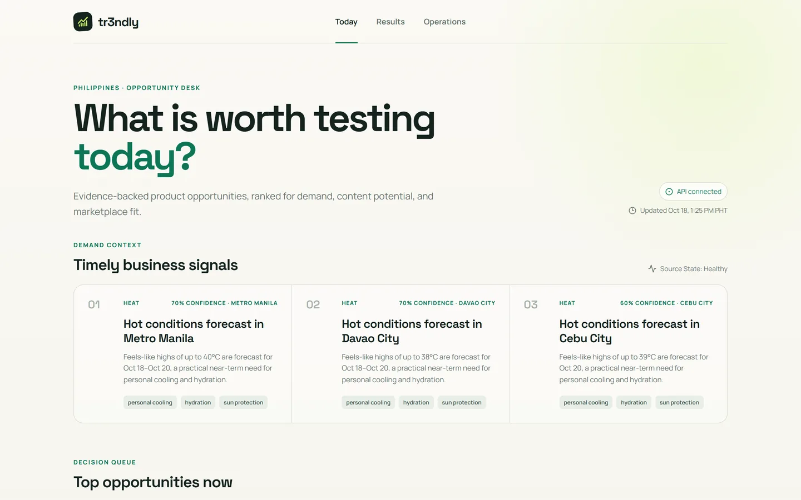
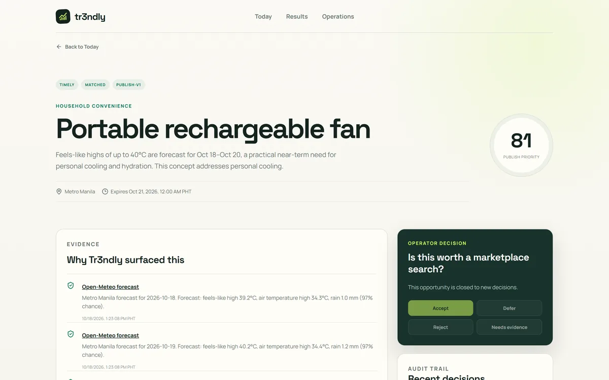
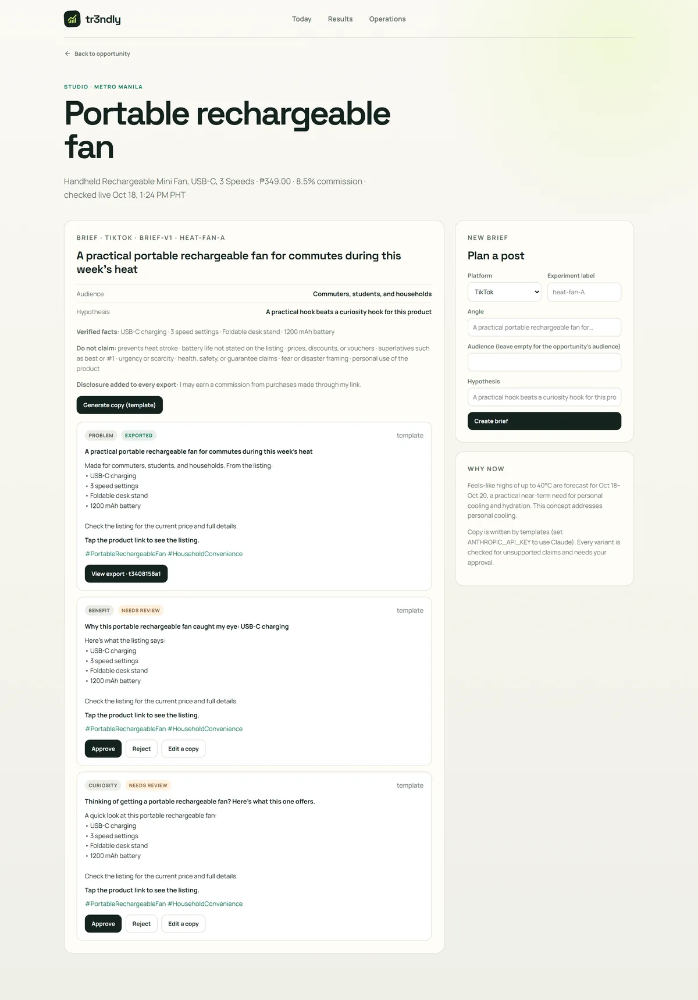
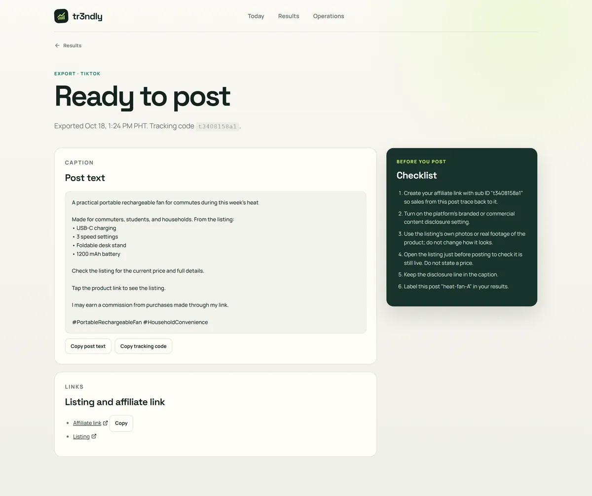
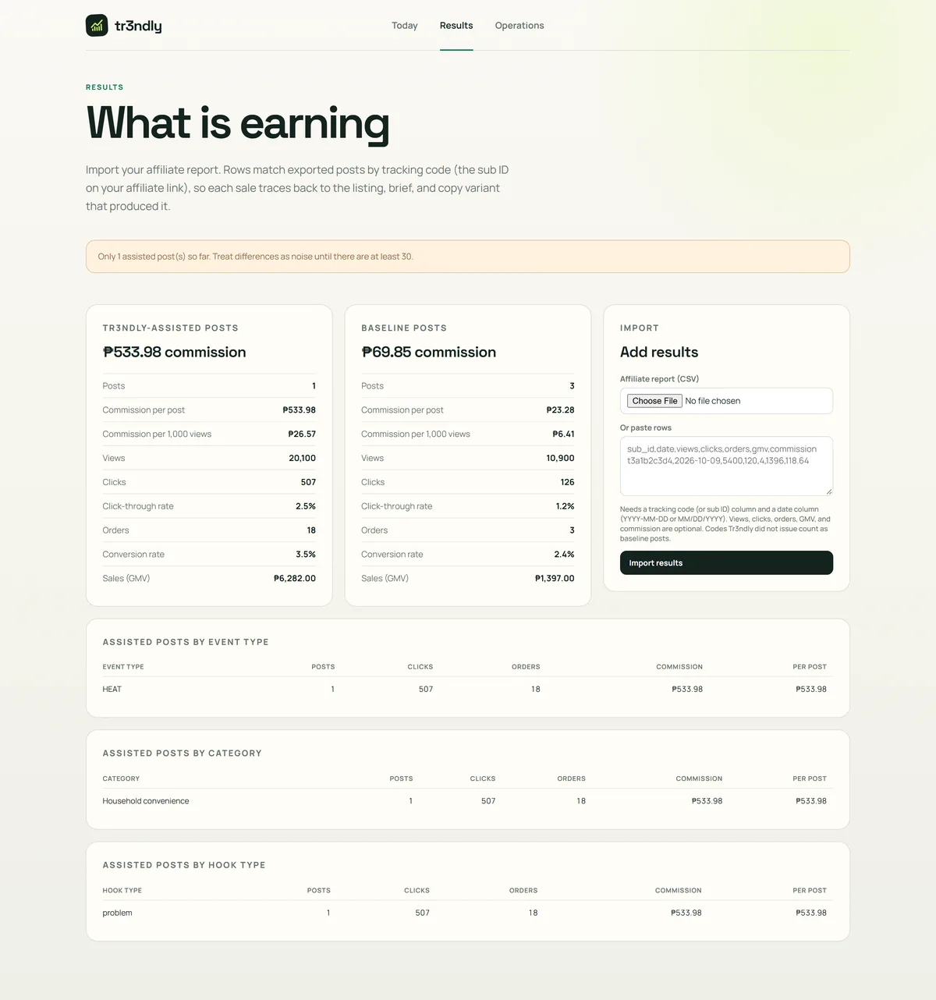
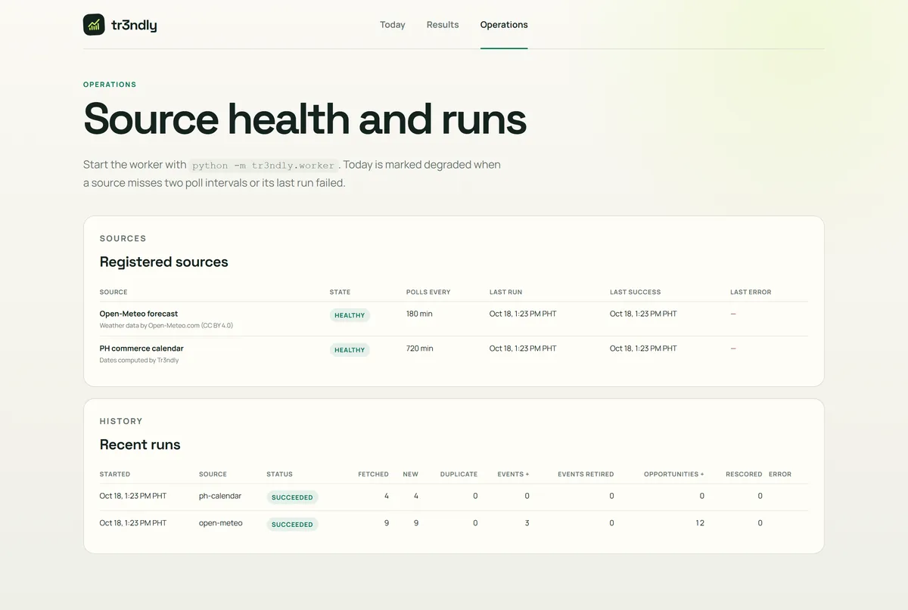

# Tr3ndly

[](https://github.com/bitwindamountains/Tr3ndly/actions/workflows/ci.yml)

Turns weather and sale-day signals into affiliate product picks for the Philippines. A worker reads weather forecasts and a commerce calendar, turns them into consumer needs and product ideas, scores them, and queues them for an operator to review, write up and post.



## How it works

1. **Signals:** Open-Meteo forecasts for Metro Manila, Cebu City and Davao City produce heat and heavy-rain events. A computed Philippine commerce calendar adds double-day sales, paydays, and the gifting and back-to-school seasons.
2. **Opportunities:** each event becomes consumer needs and generic product concepts, scored and placed in the **Today** queue.
3. **Operator review:** a person searches the marketplace, adds the real listing and its verified facts, and decides whether to publish.
4. **Copy and export:** the Studio writes post copy that is checked for unsupported claims, then exports it with the affiliate disclosure and a tracking code.
5. **Results:** importing the affiliate report shows how assisted posts did against the baseline.

## Walkthrough

**1. Decide on an opportunity.** The evidence behind each idea, a score, and an accept, defer or reject decision kept in an audit trail. After the real listing is added and confirmed live, the score switches to publish priority, which includes the listing's price and commission.



**2. Write the post.** A brief built from verified listing facts, with the claims the copy may not make spelled out. Three copy variants come from Claude when `ANTHROPIC_API_KEY` is set, or from templates otherwise. Editing a variant saves it as a new one.



**3. Export it.** Post text with the affiliate disclosure, a tracking code to use as the affiliate sub ID, and a checklist for posting by hand.



**4. Measure results.** Import the affiliate report as CSV. Rows match exports by tracking code; other codes count as baseline posts.



**5. Watch the sources.** Each data source's health and every worker run, so a stale forecast is visible.



## Engineering highlights

- **Copy can't overclaim:** every variant is checked against the listing's verified facts. Prices, superlatives, urgency, health or safety claims, durability claims, fear framing and numbers that aren't in the facts fail validation before anything can be exported.
- **Auditable decisions:** accepting, deferring or rejecting an opportunity is recorded, and failed marketplace searches are logged too.
- **Reliable worker:** each source run is recorded with its outcome, and source health is visible in the app and at `GET /operations/sources`. The app switches from demo to live data only after a real run succeeds.
- **Token never reaches the browser:** the web app talks to the API only from the Next.js server, and every API route except `/health` requires a bearer token when one is configured. Production refuses to start without it.
- **Tested on both databases:** CI runs 87 Python tests on SQLite and again on PostgreSQL, plus 8 web tests, lint, type checks and a production build. A separate script measures the copy policy's pass rate.

## Tech stack

| Part | Technology |
| --- | --- |
| API and worker | Python 3.12, FastAPI, SQLAlchemy 2 (async), Alembic, structlog |
| Data | SQLite by default, PostgreSQL (asyncpg) for shared or deployed use |
| Copywriting | Anthropic API (optional), template fallback, rule-based claim checker |
| Web | Next.js 16, React 19, TypeScript |
| Quality | pytest, Ruff, Vitest, GitHub Actions |

## Run it locally

### API

```powershell
py -3.12 -m venv .venv
.venv\Scripts\python.exe -m pip install -e ".[dev]"
.venv\Scripts\python.exe -m alembic upgrade head
.venv\Scripts\python.exe scripts\seed_demo.py
.venv\Scripts\python.exe -m uvicorn apps.api.app.main:app --reload
```

The default database is SQLite, so development works without Docker. Set `DATABASE_URL` to an async PostgreSQL URL for shared or deployed environments. Copy `.env.example` to `.env` first.

### Worker

```powershell
.venv\Scripts\python.exe -m tr3ndly.worker          # polls due sources every WORKER_TICK_SECONDS
.venv\Scripts\python.exe -m tr3ndly.worker --once   # run enabled sources now, then exit (cron or Task Scheduler)
```

Run exactly one worker per database. Open-Meteo's free API is for non-commercial use; in production set `OPEN_METEO_API_KEY`, or the app refuses to start. Attribution (CC BY 4.0) is shown in the Today footer.

### Web

```powershell
npm.cmd install
npm.cmd run dev:web
```

Copy `apps/web/.env.example` to `apps/web/.env.local` first. Open http://localhost:3000 for **Today**, `/results` for results and `/operations` for source health. The API runs at http://localhost:8000 with OpenAPI docs at `/docs`.

### Before exposing it anywhere

Both apps are open locally unless you set the secrets:

- **API (`.env`):** set `OPERATOR_TOKEN` to 32+ random characters. `ENVIRONMENT=production` refuses to start without it.
- **Web (`apps/web/.env.local`):** set `API_OPERATOR_TOKEN` to the same token, `OPERATOR_PASSWORD` to enable the sign-in page, and `SESSION_SECRET` to 32+ random characters.

## Checks

```powershell
.venv\Scripts\python.exe -m pytest
.venv\Scripts\python.exe -m ruff check .
.venv\Scripts\python.exe -m ruff format --check .
npm.cmd run lint:web
npm.cmd run typecheck:web
npm.cmd run test:web
npm.cmd run build:web
.venv\Scripts\python.exe scripts\eval_copy.py   # copy policy pass rate; calls Claude when a key is set
```

## Documentation

- [Development notes](docs/dev-notes/): the master build plan, the original system architecture and the progress log
